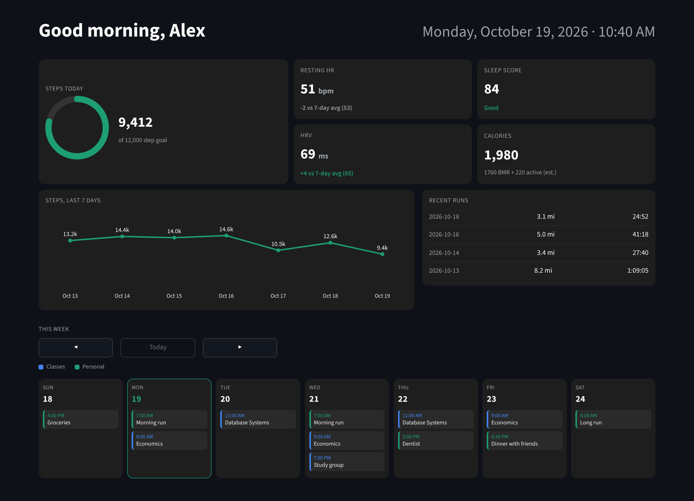

# Garmin Health Dashboard

A personal health dashboard that pulls daily metrics from Garmin Connect, stores them in a local SQLite database, and displays them in a dark, kiosk-style Streamlit app alongside a weekly calendar view.



*Shown with sample data.*

## What it shows

- **Steps today** with a progress ring against a daily goal
- **Resting heart rate** and **HRV**, each compared to the 7-day average and color-coded
- **Sleep score** labeled Good / Fair / Low
- **Calories**, split into estimated BMR (Mifflin-St Jeor) and active calories
- **Steps over the last 7 days** as a Plotly line chart
- **Recent runs** with distance and duration
- **Week-at-a-glance calendar** merged from one or more Google Calendar iCal feeds, with recurring events expanded and week-by-week navigation

## How it works

```
Garmin Connect API ──> pull_garmin.py ──> health.db (SQLite) ──> dashboard.py (Streamlit + Plotly)
                                                                     ^
                                         Google Calendar iCal feeds ─┘
```

| File | Purpose |
|---|---|
| `pull_garmin.py` | Logs in to Garmin Connect and upserts today's stats. `full` mode pulls steps, resting HR, calories, sleep score, HRV, and the past week of runs. `partial` mode refreshes only steps and calories for quick updates during the day. |
| `backfill_garmin.py` | Fills in historical days so charts and 7-day averages have a full window on first run. |
| `dashboard.py` | Streamlit app that reads the database, computes comparisons, and renders the cards, chart, and calendar. Queries are cached to keep it responsive. |
| `launch_dashboard.sh` | Starts the Streamlit server if needed and opens it full screen in a browser app window, for use as a wall or desk display. |

## Setup

```bash
python3 -m venv .venv
source .venv/bin/activate
pip install -r requirements.txt

cp .env.example .env      # then fill in your Garmin login and optional settings

python backfill_garmin.py 14   # seed the last two weeks
python pull_garmin.py full     # pull today's full stats
streamlit run dashboard.py     # or ./launch_dashboard.sh for full-screen mode
```

Run `python pull_garmin.py full` once each morning and `python pull_garmin.py partial` a few times during the day (manually or from a scheduler like cron) to keep the numbers current.

## Tech stack

Python, SQLite, Streamlit, Plotly, pandas, [garminconnect](https://github.com/cyberjunky/python-garminconnect), icalendar, recurring-ical-events

## Privacy

Credentials live only in a local `.env` file and health data stays in a local `health.db`. Both are excluded from version control by `.gitignore`.
